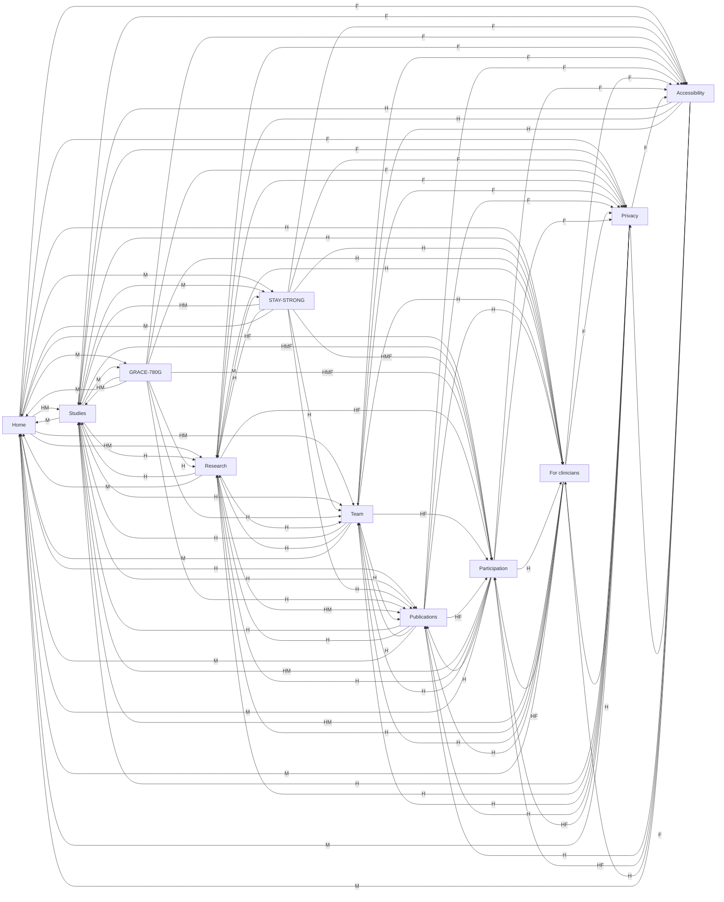

# Website link graph

Generated 2026-10-31 from the built site (English tree; Hebrew mirrors it). Edge labels: **H** header, **M** main content, **F** footer. Brand and language-switch links are omitted; anchor links collapse to their page.

## Redundancy findings

- **No duplicate destinations inside any page’s main content.** Home’s three links to Research are distinct section anchors (`#cognition`, `#movement`, `#technology`), not repeats of one destination.
- No self-links in main content.
- **Header + footer both link to Participation on every page** — the one true global duplication. Footer support links (Privacy, Accessibility) are footer-only; header repeats no other footer destination.
- **Reachable only through header/footer:** For clinicians, Privacy, Accessibility — expected for support/audience pages, worth noting.
- **Same destination, different labels:** Studies (Studies / Explore studies→); Research (Research / Diabetes & cognitive function↗ / Muscle strength & physical function↗ / Digital assessment tools↗); Team (Team / The team→); Publications (Publications / Selected publications→); Participation (About participation / About participation→); GRACE-780G (GRACE-780G→ / Read study→); STAY-STRONG (STAY-STRONG→ / Read study→ / STAY-STRONG study page→).

## Notes
- Main-content fan-out shows each page’s real next steps.
- Different labels for the same destination are only a problem when they compete on one page; contextual CTAs (“Read study”, “Explore studies”) are expected.
